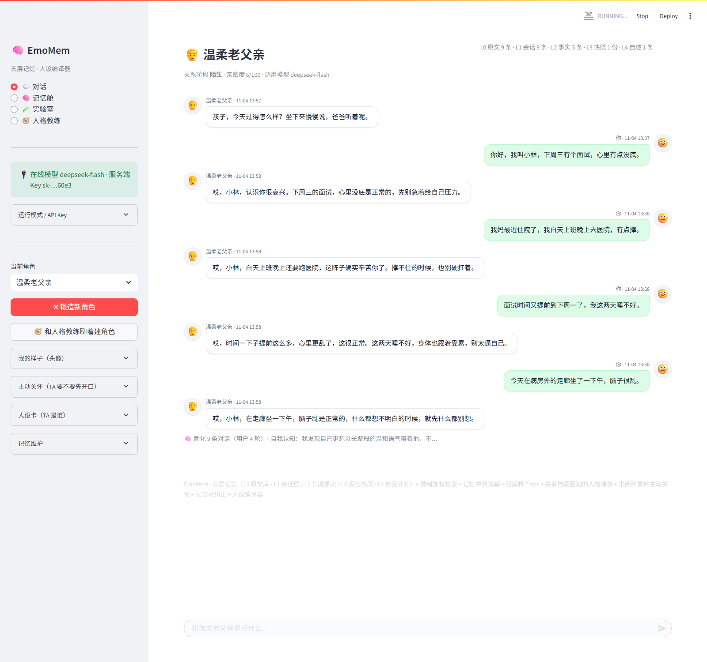
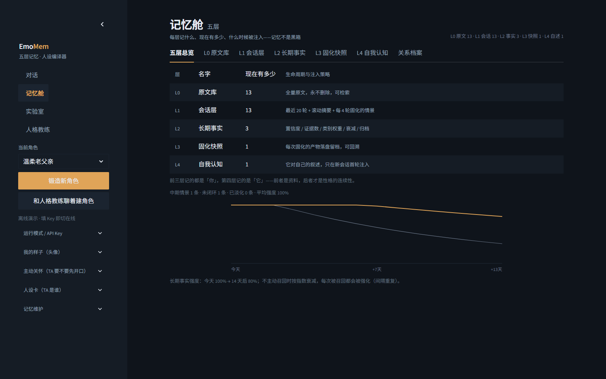
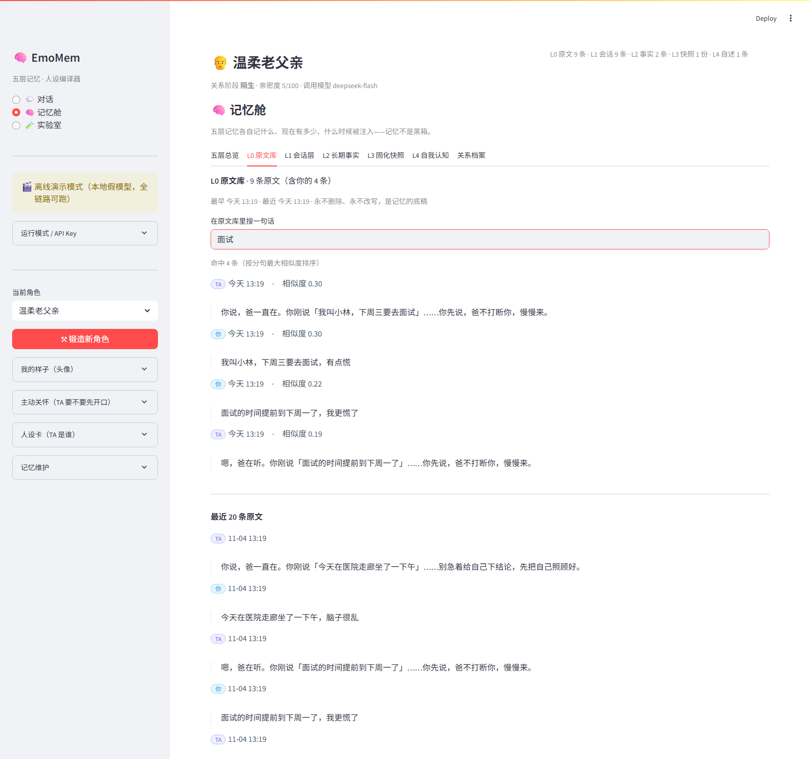
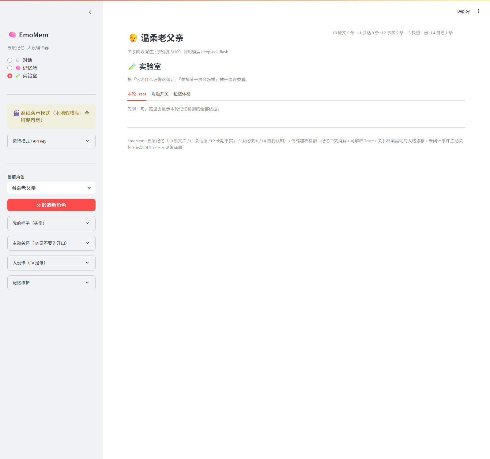
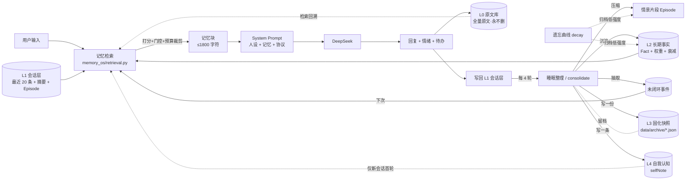

# EmoMem · 情感陪伴 Agent（五层记忆 + 人设编译器）

> 一个会**记住你**、并且**记得有分寸**的情感陪伴 Agent。
> 五层记忆：原文库（L0）→ 会话层（L1）→ 长期事实（L2）→ 固化快照（L3）→ 自我认知（L4），
> 每 4 轮自动「睡眠整理」；检索按「相似度 × 重要性 × 时间衰减 × 情绪显著性」打分，会主动压制翻旧账；
> 记忆可查、可删、可纠正，关系档案驱动人格漂移，未闭环的事会主动回访；
> 角色由**人设编译器**从一句话描述现场铸造。

- 纯 Python 标准库实现记忆层（无向量库、无 embedding 服务），`pip install -r requirements.txt` 即可跑
- **没 API Key 也能完整演示**：离线假模型会把五层记忆、固化、冲突消解、人设编译全链路跑通
- 全部逻辑有离线单测覆盖（`pytest`），关键参数集中在 `core/config.py`，现场可用开关逐项消融

---

## 1. 它和普通「AI 伴侣」有什么不同

| # | 创新点 | 一句话 | 在代码里 |
|---|---|---|---|
| 1 | **五层记忆结构** | L0 原文库永不删可检索 → L1 会话层 → L2 长期事实 → L3 固化快照留档 → L4 自我认知（它对自己的叙述） | `memory_os/schema.py` `engine.py` |
| 2 | **记忆固化 + 每 4 轮睡眠整理** | 一次调用同时产出情景片段、事实、未闭环事件、称呼、关系增量与一条自我叙述 | `memory_os/consolidate.py` |
| 3 | **情绪加权检索 + 防翻旧账** | 每条记忆带效价/唤醒度；用户难受时，不主动把未提及的旧伤口翻出来 | `memory_os/retrieval.py` |
| 4 | **记忆冲突消解** | 新旧事实矛盾时旧条目打 `superseded_by` 作废，保留审计而不删数据 | `memory_os/consolidate.py` |
| 5 | **可解释记忆 Trace + 记忆主权** | 每轮都能看到注入了哪几条、为什么、各项分值、没采用哪些；每条记忆还能「忘掉」或「改正」 | `ui/panels.py:render_trace` |
| 6 | **关系档案驱动人格漂移** | intimacy/trust/stage/称呼演化/共同梗，阶段反过来调节语气（陌生克制 → 亲密可调侃） | `persona_forge/render.py` |
| 7 | **未闭环事件 + 主动关怀** | 从对话里抽取面试/体检/约定，下次主动追问；附带 5 个消融开关供现场对比 | `memory_os/retrieval.py` |
| 8 | **人设编译器 Persona Forge** | 一句描述 → 结构化人设卡 → 6 维自评 → 定向重写 → 3 问人设体检 | `persona_forge/compiler.py` |

和同类项目的定位差异：

| | EmoMem | 典型长上下文方案 | 向量库记忆插件 | 纯人设 Prompt |
|---|---|---|---|---|
| 分层结构 | 五层，各有寿命与注入策略 | 单一大窗口 | 单一向量集合 | 无 |
| 自我认知 | L4 记「它自己」，只在新会话首轮注入 | 无 | 无 | 仅提示词描述 |
| 遗忘机制 | 指数衰减 + 召回强化 + 归档 | 无（靠截断） | 无 | 无 |
| 情绪感知 | 效价/唤醒度参与打分与门控 | 无 | 无 | 无 |
| 冲突处理 | `superseded_by` 审计式作废 | 无 | 覆盖写 | 无 |
| 可解释性 | 每轮 Trace 可查，可删可改 | 无 | 相似度分数 | 无 |
| 人格演化 | 关系阶段反向调节语气 | 无 | 无 | 静态 |
| 部署成本 | 零第三方依赖 | 需大窗口模型 | 需向量库/服务 | 极低 |

---

## 2. 快速开始

```powershell
pip install -r requirements.txt

# ① 有 Key：先设环境变量，再启动（PowerShell 写法，注意是 $env: 不是 set）
$env:DEEPSEEK_API_KEY = "sk-你的真实key"
python -c "from core import llm; print(llm.mode_label())"   # 自检：应输出「在线模型 deepseek-flash」
streamlit run app.py

# ② 没 Key：自动进入离线演示模式；也可以显式强制
$env:EMO_DEMO_MODE = "1"
streamlit run app.py
```

> **`set` 是 cmd 的写法，在 PowerShell 里不生效**：`set DEEPSEEK_API_KEY=sk-...` 只会创建一个名字叫
> `DEEPSEEK_API_KEY=sk-...` 的 PowerShell 变量，环境变量仍然是空的，于是应用判定「没有 Key」→ 继续走离线演示模式。
> cmd 用户请用 `set DEEPSEEK_API_KEY=sk-你的真实key`（同一行、等号两边不要空格、不要保留占位符 `sk-xxxx`）。
> 环境变量只在**当前这个终端**有效，且必须在启动 `streamlit` **之前**设好；换个终端窗口就要重设。

界面上也可以直接粘贴 Key（侧边栏「运行模式 / API Key」→ 密码框 → 应用 Key），不用重启。
**这个 Key 只活在你自己的浏览器会话里**：不进环境变量、不落盘、不写日志，页面只显示末 4 位指纹（如 `sk-…9999`），
别的访客看不到明文、也用不到你的额度；点「清除 Key」或关掉浏览器即失效。
若 Key 写成了占位符（含 `xxxx` 或不是 `sk-` 开头），侧边栏会直接提示，而不是默默降级。

界面左侧（侧边栏）三个视图：

- **💬 对话**：满宽聊天区，**你的气泡在右边、TA 的在左边**，各带自己的头像；气泡下方显示本轮情绪、追问、待办与记忆更新
- **🧠 记忆舱**：五层总览 / L0 原文库（可搜索）/ L1 会话层 / L2 长期事实（可改正、可忘掉）/ L3 固化快照 / L4 自我认知 / 关系档案
- **🧪 实验室**：本轮 Trace（注入了什么、为什么、抑制了什么）/ 5 个消融开关 / 记忆体检

侧边栏还管几件"属于你"的事：**我的样子（头像）**（8 个预设 + 自定义 emoji，只影响你的气泡，不写进角色卡）、
**主动关怀**（TA 要不要先开口，可一键关掉）、**运行模式 / API Key**（见上一节）。TA 的头像也能改：展开「人设卡（TA 是谁）」→ 改「TA 的头像」→ 换头像（内置角色同样支持）。

| 环境变量 | 默认值 | 说明 |
|---|---|---|
| `DEEPSEEK_API_KEY` | 无 | 未设置且未开演示模式时，自动降级为离线演示模式 |
| `DEEPSEEK_MODEL` | `deepseek-flash` | 对话与结构化调用使用的模型 |
| `EMO_DEMO_MODE` | 未设置 | 设为 `1` 强制离线演示模式（答辩兜底） |

界面预览（离线演示模式，五轮对话之后）：

| 对话 | 记忆舱 · 五层总览 |
|---|---|
|  |  |

| L0 原文库 · 搜索 | 实验室 · 本轮 Trace |
|---|---|
|  |  |

自检：

```bash
python -m pytest -q                 # 离线单测
python scripts/eval_memory.py       # 记忆机制评测，输出 docs/poster/metrics.json
```

---

## 3. 五层记忆架构



**五层各管什么**

| 层 | 名字 | 存什么 | 寿命 / 注入策略 |
|---|---|---|---|
| L0 | 原文库 | 全部对话原文（`data["chats"]`） | **永不删除、永不改写**；不注入，需要时按关键词检索（回答「它是在哪句话里记住我的」） |
| L1 | 会话层 | 最近 20 条 turn + 滚动摘要 + 每 4 轮固化的 Episode（标题/摘要/话题/效价/唤醒度/重要性） | 轮次裁剪；最近 8 条逐字回放 + 打分取 Top-K（默认 4 条 Episode） |
| L2 | 长期事实 | 稳定事实：身份/喜好/厌恶/重要人物/长期目标/近况/禁忌/约定 | τ=30 天衰减，证据越多越稳；打分取 Top-K（默认 8 条）+ 置顶兜底 |
| L3 | 固化快照 | 每次「睡眠整理」的产物（Episode + 新增/更新的事实 + 自我叙述） | 落盘 `data/archive/<角色>/<id>.json` + 索引，可回溯历史版本 |
| L4 | 自我认知 | `selfNote`：**它自己的**叙述（"我好像慢慢知道，面试这件事对ta来说不是小事"） | 上限 40 条；**只在新会话首轮注入一次**（每轮都灌就不是成长，是洗脑） |

> 前三层记的都是「你」，L4 记的是「它」。前者是资料，后者才是性格的连续性。

**四种机制**

1. **固化（consolidate）**：每 4 个用户轮触发一次，一次 LLM 调用同时产出「情景片段 + 事实 + 未闭环事件 + 称呼 + 关系增量 + 一条自我叙述」，逐字段校验降级，并写一份快照留档；LLM 失败时用正则兜底（`used_llm=False`）。
2. **冲突消解**：新事实与旧事实相似度高且语义矛盾（喜欢/讨厌、否定差异）→ 旧条目写 `superseded_by`，不再注入，但文件里保留可审计；同义高相似（>0.82）则合并为一条，`evidence_count+1`、`confidence+0.1`。
3. **遗忘（decay）**：`strength = base × exp(-Δt/τ) × (1 + 0.12 × recall_count)`；低于 0.15 标记归档（不删除、不再注入、界面标灰）；每次被召回会强化（间隔重复）。
4. **情绪门控（防翻旧账）**：检索时若用户情绪为难过/生气，且某条记忆是高唤醒负性（valence < -0.3 且 arousal > 0.6）且与本轮话题几乎无关（相似度 < 0.25）→ 不注入，并在 Trace 里写明「抑制 1 条高唤醒负性记忆（防翻旧账）」。门槛不是死的：关系档案里的**信任**越高越敢碰旧事，相似度门槛最多放宽 30%（信任 100 时是 0.175）——这也是信任值唯一参与决策的地方。

**记忆主权：可查、可删、可改**

| 能力 | 入口 | 行为 |
|---|---|---|
| 查 | 记忆舱 →「L0 原文库」搜索框 | 按关键词回到原始那句话，带时间戳与相似度 |
| 删 | 中期 Episode / 长期事实右侧「🗑 忘掉」 | 真的从文件里删掉这一条（其余不受影响） |
| 改 | 长期事实右侧「✏️ 改正」 | 新增一条 `confidence=0.9` 的事实，旧事实标 `superseded_by` 留档 |

**可调参数（`core/config.py`）**

| 参数 | 值 | 含义 |
|---|---|---|
| `SHORT_TERM_MAX_TURNS` / `SHORT_TERM_INJECT_TURNS` | 20 / 8 | 短期保留条数 / 逐字注入条数 |
| `CONSOLIDATE_EVERY_TURNS` | 4 | 每几轮固化一次 |
| `W_SIM / W_IMP / W_REC / W_EMO` | 0.45 / 0.20 / 0.20 / 0.15 | 检索四项权重 |
| `EPISODE_TAU_DAYS / FACT_TAU_DAYS` | 10 / 30 | 中期、长期遗忘时间常数（天） |
| `ARCHIVE_THRESHOLD` | 0.15 | 归档阈值 |
| `MEMORY_BLOCK_BUDGET` | 1800 | 注入记忆块的字符预算 |
| `FACT_MERGE_SIM / FACT_CONFLICT_SIM` | 0.82 / 0.50 | 事实合并、冲突判定阈值 |
| `STAGE_THRESHOLDS` | 20 / 45 / 75 | 陌生 → 熟悉 → 亲近 → 亲密 |
| `ARCHIVE_TOP_K` | 5 | L0 原文库检索返回条数 |
| `SELF_NOTE_MAX / SELF_NOTE_MERGE_SIM / SELF_NOTE_INJECT_MAX` | 40 / 0.80 / 3 | L4 自我认知上限、去重阈值、注入条数 |
| `SNAPSHOT_MAX` | 30 | L3 快照索引上限 |
| `CORRECTION_CONFIDENCE` | 0.90 | 用户亲手纠正后的事实置信度 |

---

## 4. 记忆怎么被选中：检索打分

```python
sim     = cosine(tfidf(query), tfidf(item))          # 纯 Python，字符 2-gram
recency = exp(-Δt_days / τ)                          # Episode τ=10d，Fact τ=30d
emotion = 0.5 * |valence| + 0.5 * arousal            # Fact 无该字段时取 0.4
score   = 0.45*sim + 0.20*importance + 0.20*recency + 0.15*emotion
```

- `importance`：Episode 由固化时给出；Fact = `confidence × 类别权重`（禁忌/约定/身份 1.0 → 近况 0.6）
- 禁忌/约定类事实额外 `+0.12`，保证「别踩的坑」永远有机会被读出来
- 置顶兜底：`confidence ≥ 0.7` 的身份/禁忌/约定最多 2 条 + 全部未闭环事件（≤3 条）必注入
- 超预算按分数升序裁剪，并在 Trace 的 `notes` 里写清裁了谁
- **L0 原文库与 L4 自我认知不参与打分**：L0 只在用户主动搜索时按需回溯（不进 prompt），L4 只在新会话首轮整体注入一次（≤3 条），避免「每十秒被告知你是谁」

**一个实际例子**（用户在难受时说「我还是不想去面试」）

| 记忆 | 层 | sim | importance | recency | emotion | score | 结果 |
|---|---|---|---|---|---|---|---|
| 「下周三要去面试」 | 中期 | 0.62 | 0.72 | 0.94 | 0.55 | 0.70 | ✅ 注入 |
| 「上次被前公司裁员，哭了很久」 | 中期 | 0.18 | 0.80 | 0.66 | 0.88 | **被门控** | 🚫 抑制（防翻旧账） |
| 「用户讨厌被催」 | 长期·禁忌 | — | 0.95 | 0.99 | 0.40 | 置顶 | ✅ 必注入 |

---

## 5. 可解释 Trace：每轮都能查（可查 · 可删 · 可改）

顶部切到「🧪 实验室 → 本轮 Trace」标签页，展示上一轮的全部依据：

- **注入了什么**：层级 / 类型 / 内容 / 总分 / 相似度·重要性·新鲜度·情绪四项分解 / 是否置顶 / 中文理由
- **没采用什么**：被情绪门控或预算裁掉的条目，逐条给出原因
- **本轮记忆块原文** 与 **完整 System Prompt**：答辩时可以直接指着屏幕讲「模型看到的到底是什么」

「🧠 记忆舱」里则是记忆的主权面板——不只可查，还能删和改：

| 标签页 | 你能做什么 |
|---|---|
| 五层总览 | 一眼看到 L0–L4 各有多少条、每层注入策略、遗忘曲线未来 14 天预测 |
| L0 原文库 | 输入关键词，回到「它是在哪句话里记住我的」；带时间戳与相似度 |
| L1 会话层 | 最近 20 条原文 + 滚动摘要 + 每 4 轮压出来的 Episode |
| L2 长期事实 | 按分类看 8 类事实、置信度、证据数、强度；右侧「✏️ 改正」「🗑 忘掉」 |
| L3 固化快照 | 每次「睡眠整理」的留档，可回溯历史版本 |
| L4 自我认知 | 它对自己的叙述，按成长/关系/表达/情绪分类 |
| 关系档案 | 亲密度、阶段、称呼演化、共同梗、未闭环事件 |

- **改**：纠正一条事实 → 新事实 `confidence=0.9`，旧事实标 `superseded_by` 留档（可审计，不抹掉历史）
- **删**：忘掉一条 Episode / 事实 → 真的从文件里移除，其余记忆不受影响

---

## 6. 关系档案与人格漂移

记忆不只影响「说什么」，还影响「怎么说」：

| 亲密度 | 阶段 | 语气 |
|---|---|---|
| 0–19 | 陌生 | 客气、简短，不问隐私，不用昵称 |
| 20–44 | 熟悉 | 可回忆上次话题，语气放松 |
| 45–74 | 亲近 | 可用昵称、可调侃、可表达关心 |
| 75–100 | 亲密 | 可撒娇/互怼，共享内部梗，主动追问未闭环的事 |

关系档案里还记录：称呼演化历史（`昵称 A → B`）、共同梗（inside jokes，≤5）、反复出现的话题（≤8）。

---

## 7. 未闭环事件与主动关怀

固化时顺带抽取「待跟进事项」：`{"what": "下周三去面试", "kind": "待办", "due_hint": "下周三"}`。
下次进入对话时，界面上会出现「TA 想先问一句」，可一键让 TA 先开口；谈完了点「已完成」即可闭环。
同一件事反复被提到时 `mention_count+1`，不会重复堆成多条。

**主动开口不是寒暄，是接着具体的事问**。素材按优先级取三类（`memory_os/engine.py::_proactive_hooks`）：

| 优先级 | 素材 | 例子 |
|---|---|---|
| 1 | 未闭环事件 | 「上次你提到下周三要去面试，后来怎么样了？」 |
| 2 | 最近聊过的话题（Episode 的 keywords） | 「上次你聊到 面试 · 上班，后来有变化吗？」 |
| 3 | 长期事实里的近况/目标/喜好 | 「我还记得你说过用户的妈妈最近住院，最近还好吗？」 |
| 兜底 | 连短期层都还没有 | 「你刚说的「在地铁上被人踩了一脚」，我还记着——现在怎么样了？」 |

只有一条素材都取不到时才会退回「今天过得怎么样」这种通用问候；而**只剩通用问候时界面干脆不显示这块**，
所以评委看到的那句话一定是"接着某件具体的事"。整个功能可以在侧边栏「主动关怀」里一键关掉
（关掉后既不显示、也不会为此多调一次模型）。

---

## 8. 人设编译器：把「生成人设的提示词」升级成流水线

旧做法（一句描述 → 两个字符串）：

```text
用户描述 → LLM → {"persona": "...", "opening": "..."}
```

新做法（`persona_forge/`）：

```text
一句描述 + 4 个旋钮(毒舌/温柔/话痨/神秘)
   ↓ ① seed：结构化人设卡（含语音指纹、情绪反应表、关系弧、边界、禁忌、反套路、3 条台词锚点）
   ↓ ② critique：6 维自评（可执行性/一致性/差异化/情感深度/安全性/可演示性，各 0-100 + 可执行 issue）
   ↓ ③ repair：只改被点名的部分，未点名字段原样保留（≤1 轮）
   ↓ ④ healthcheck：3 个探针问题实际扮演一遍，检查是否「活得起来」
   → 人设卡（JSON 可存可审）+ 自评 + 体检报告 + 编译轨迹
```

元 Prompt 里做了这些事（`persona_forge/prompts.py`）：

- **反陈词滥调**：禁用「温柔体贴 / 善解人意 / 阳光开朗」等空转形容词，强制用可观察行为描述（口癖、具体反应、具体边界）
- **六维自检清单**：说话风格 / 情绪触发点 / 价值观 / 知识边界 / 关系态度 / 禁忌话题，每项必须在卡里有对应字段
- **few-shot 完整卡**：给模型看一张「退休刑警开的馄饨摊老板」的满配卡，示范什么叫具体感
- **台词锚点**：必须给 3 条能立刻区分角色的话（高兴时 / 被冒犯时 / 安慰人时）
- **定向重写**：「再丰富一点」这种评语被明令禁止，必须写「把 X 改成 Y」

人设卡字段：`identity`（年龄气质/职业/场景）、`backstory`、`values`、`speech`（语域/平均句长/口癖/标点习惯/禁语/3 条台词）、`emotion_map`（触发 → 反应 + 身体语言）、`relationship_arc`（四阶段语气）、`boundaries`、`taboos`、`anti_patterns`、`memory_hooks`。

---

## 9. 离线演示模式

答辩现场最怕网络抽风。项目内置 `core/demo.py`：

- 无 `DEEPSEEK_API_KEY` 时自动启用（或显式 `EMO_DEMO_MODE=1`）
- 用**确定性假模型**按 `purpose` 分发：对话、固化、抽取、主动关怀、人设生成/自评/重写/体检全部有可用返回；同一输入永远同一输出，方便现场复现
- 记忆抽取用正则规则表兜底（`身份/喜好/厌恶/重要人物/近况/约定`），因此固化、冲突消解、遗忘曲线、Trace 都能真实跑起来
- 局限：措辞是模板化的，观感不如真实模型；它只负责证明「机制成立」，不负责证明「文采」

---

## 10. 项目结构

```
Emotional-Agent-main/
├── app.py                    Streamlit 入口：三视图切换（对话 / 记忆舱 / 实验室），只做编排与渲染
├── core/
│   ├── config.py             全部魔法数字、路径、情绪表、五层参数（唯一改动点）
│   ├── llm.py                唯一 LLM 入口：JSON Mode + 3 次重试 + 解析兜底 + 演示模式分流
│   └── demo.py               离线演示模式的确定性假模型（含 self_note 生成）
├── memory_os/                五层记忆引擎（零第三方依赖）
│   ├── schema.py             数据类：WorkingTurn / Episode / Fact / OpenLoop / RelationshipState / SelfNote / MemorySnapshot / Trace
│   ├── store.py              原子读写 + 版本迁移（v2/v3 → v4）+ 角色隔离 + 归档目录
│   ├── textsim.py            字符 2-gram TF-IDF 余弦 + 分句
│   ├── retrieval.py          打分、选层、情绪门控、预算裁剪、Trace 组装
│   ├── consolidate.py        固化：Episode / Fact 合并与冲突 / OpenLoop / 关系更新 / selfNote / 快照
│   ├── decay.py              遗忘曲线、召回强化、归档
│   ├── prompts.py            固化、自我叙述与主动关怀的 Prompt
│   └── engine.py             MemoryEngine 门面（写路径 + 读路径 + 原文检索 + 纠正）
├── persona_forge/            人设编译器
│   ├── prompts.py            ★ 元 Prompt：seed / critique / repair / probe
│   ├── compiler.py           seed → critique → repair → healthcheck 编排
│   ├── healthcheck.py        3 问人设体检
│   ├── render.py             人设段 / 关系语气指令 / 输出协议
│   ├── schema.py             PersonaCard 等数据类与容错互转
│   └── legacy.py             旧版纯文本人设 → 卡片
├── ui/
│   ├── state.py              会话状态、角色文件、引擎装配、单轮对话流程、原文检索 / 纠正 / 界面偏好
│   ├── chat.py               对话气泡：自己靠右、TA 靠左，HTML 转义后自绘
│   ├── panels.py             五层面板 / L0 检索 / 快照 / 自我认知 / Trace / 关系 / 遗忘曲线 / 消融
│   └── forge.py              「人设锻造炉」对话框
├── tests/                    离线单测（记忆引擎 19 / 人设编译器 20 / 集成 21 / 界面 10）
├── scripts/eval_memory.py    记忆机制离线评测，产出海报指标
├── docs/SPEC.md              内部接口契约（含 §8 五层扩展规格）
├── docs/答辩稿.md / .docx     3 分钟一页口播稿（数字与 metrics.json 一致）
├── docs/poster/              A2 海报：poster.pdf / poster.png / poster.html
│   ├── build_poster.py       一键重建海报（自带版式与裁切自检）
│   ├── make_docx.py          答辩稿 md → 一页 docx
│   ├── DESIGN.md             设计规范：配色、字号层级、重建命令、踩过的坑
│   └── metrics.json          评测指标（scripts/eval_memory.py 写入）
└── data/                     运行时生成：memory.json（v4）、custom_roles.json、settings.json、archive/<角色>/*.json
```

---

## 11. 数据结构（`data/memory.json` v4）

```jsonc
{
  "version": 4,
  "chats":   { "温柔老父亲": [{"role": "user", "content": "...", "ts": 1730700000000}] },  // L0 原文库：永不删
  "roles": {
    "温柔老父亲": {
      "turns": [ /* L1 会话层：最近 20 条 */ ],
      "working_summary": "本会话滚动摘要",
      "episodes": [ /* L1 → 中期：Episode */ ],
      "facts": [ /* L2 长期：Fact（含 confidence / evidence_count / superseded_by） */ ],
      "open_loops": [ {"what": "下周三去面试", "kind": "待办", "due_hint": "下周三", "status": "open"} ],
      "relationship": {"intimacy": 18.4, "trust": 6.0, "stage": "陌生", "nickname": null},
      "self_notes": [ /* L4 自我认知 */ {"id": "self_9f2a01c3d4", "content": "聊到「面试」，我学会先问一句「然后呢」，而不是马上给建议。", "note_type": "表达", "created_at": 1730700000000, "updated_at": 1730700000000, "mention_count": 2} ],
      "snapshots": [ /* L3 固化快照索引 */ {"id": "snap_7b1c9a2e05", "created_at": 1730700000000, "label": "第 4 轮固化", "episode_id": "ep_1a2b3c", "episode_title": "聊到 面试 · 住院", "facts_added": 3, "facts_updated": 1, "self_note": "…", "path": "data/archive/温柔老父亲/snap_7b1c9a2e05.json"} ],
      "last_consolidated_turn": 8,
      "turn_counter": 9
    }
  },
  "shared_facts": [ /* 跨角色共享的客观信息（身份/重要人物/长期目标/禁忌） */ ],
  "meta": {}
}
```

- 兼容 v3 / v2（`{"chats": ..., "memories": ...}`）/ 更早的 `{"角色名": [消息]}`，读取时自动迁移（v2 的字符串记忆会变成「近况」类事实，置信度 0.5，属有损迁移，首次升级前建议备份 `data/memory.json`）
- 原子写入（`tmp` + `os.replace`，Windows 下带重试），文件损坏时备份后重建，不会把数据写坏
- L3 快照正文落在 `data/archive/<角色>/<快照id>.json`，`memory.json` 里只留索引（最多 30 条），避免主文件膨胀
- 自定义角色存 `data/custom_roles.json`，v3 结构存整张人设卡，v1 的纯文本 `persona/opening` 也能读

---

## 12. 工程细节（为什么这么写）

1. **零第三方依赖的记忆层**：字符 2-gram TF-IDF 纯 Python 实现，不需要 embedding 服务、不需要向量库；对中文短句足够，且完全可测
2. **单一 LLM 入口**：所有调用收敛到 `core/llm.call_json(purpose=...)`，重试/降温度/去历史/JSON 修复只写一遍
3. **时间可注入**：所有记忆函数接受 `now` 参数，单测里把时间往后拨 60 天就能验证遗忘曲线，无需 sleep
4. **LLM 失败不等于功能失败**：固化失败走正则兜底、人设编译失败走模板卡，界面永远有东西可看
5. **脏数据容错**：`dict_to_card` / `Fact` 解析对缺字段、类型错误逐项清洗，绝不因为模型返回畸形 JSON 而崩溃
6. **消融开关**：中期层、长期层、情绪门控、冲突消解、自动固化 5 个开关都能在界面上关掉，现场对比
7. **可解释优先**：每轮检索都留 Trace，讲得清楚比跑得好看重要
8. **写盘安全**：tmp + replace 原子写（Windows 下遇到文件占用会退避重试）；角色之间数据隔离；清空操作有二次确认入口
9. **L4 只注入一次**：自我认知不是每轮喂给模型，而是在新会话首轮读一次——每十秒告诉模型「你是谁」会让它变成复读机；条数上限 40、注入上限 3 条
10. **L3 快照只做索引**：正文单独落盘，主文件不会膨胀；快照写失败只记一条 note，不影响本轮固化
11. **主权优于自动化**：任何被记下来的东西，用户都能查到原文、删掉单条、或改成自己认可的说法；「改」用 `superseded_by` 留痕，不静默覆盖
12. **气泡自己画**：Streamlit 原生 `st.chat_message` 一律左对齐，做不出"自己说的话在右边"；所以整段对话一次 HTML 渲染，用户文本先 `html.escape` 再换行，模型输出不会变成可执行标记
13. **偏好与角色分离**：头像、是否允许主动开口属于"用户偏好"，存 `data/settings.json`，换角色不丢；角色卡只管"TA 是谁"

---

## 13. 现场怎么做消融实验（30 秒版）

左侧三个视图：**💬 对话** / **🧠 记忆舱** / **🧪 实验室**。

1. 聊 4 轮（触发一次固化）→ 切「🧪 实验室 → 本轮 Trace」，讲清这轮注入了什么、抑制了什么
2. 切「🧠 记忆舱」看五层总览：L0 原文、L1 会话、L2 事实、L3 快照、L4 自述各有多少条
3. 在「L0 原文库」搜一个关键词（如"面试"），指给评委看「它是在哪句话里记住我的」
4. 在「L2 长期事实」点「✏️ 改正」改一条事实 → 旧条目变成 `superseded_by` 留档；再点「🗑 忘掉」删一条 → 真的消失
5. 回「🧪 实验室 → 消融开关」：关掉「长期记忆」→ 再聊一句，观察 TA 是否"忘了"你的禁忌/身份
6. 关掉「情绪门控」→ 在难过时提一句不相关的话题，观察旧伤口是否被翻出来
7. 关掉「自动固化」→ 中期层不再增长，点「立即固化一轮记忆」手动补一次
8. 打开「人设锻造炉」现场编译一个新角色（有 Key 时约 4 次 LLM 调用，无 Key 时走演示模板）

---

## 14. 实测数据

指标由 `scripts/eval_memory.py` 离线跑出（40 轮脚本化对话 + 演示模型 + 剧本化假 LLM，可复现），脚本同时写入 `docs/poster/metrics.json`，海报与答辩稿引用同一份数据：

| 指标 | 数值 |
|---|---|
| 对话轮数 / 固化批次 | 40 轮（20 组）/ 5 批（每 4 轮一次） |
| 原始对话字符 → 注入记忆块字符 | 1912 → 1275（上下文占用 **66.7%**，即省下 **33.3%**） |
| 召回命中（5 条预埋探针） | **5 / 5**（小林 · 下雨天 · 住院 · 阿远 · 面试） |
| 事实条目 | 18 条，17 条有效，1 条被冲突消解取代（`superseded_by` 留档） |
| 情景 / 未闭环事件 | 5 条 / 1 条 |
| 情绪门控触发 | 5 次（40 轮中被跳过 5 条旧负向记忆） |
| 平均记忆强度（遗忘曲线） | d0 0.998 → d7 0.724 → d30 0.295 → d60 0.105 |
| 五层规模（L0 / L3 / L4） | 原文 40 条 / 快照 5 份 / 自我叙述 5 条 |

> 说明一：压缩率 = 记忆块字符 / 原始对话字符，**33% 是省下的、不是压掉的**；块里短期窗口的 8 轮原文占大头，会话越长这个比例越低。
> 说明二：这些数字衡量的是**机制**（是否命中、是否抑制、是否衰减），不是模型文采；换成真实 API Key 后机制不变，只是措辞更好。

---

## 15. 答辩材料

- `docs/poster/poster.pdf`：A2 竖版海报（420×594mm，1 页）
- `docs/poster/poster.png`：海报 1588×2245 预览图
- `docs/答辩稿.md` / `docs/答辩稿.docx`：3 分钟一页口播稿（900–1100 字）
- `docs/poster/DESIGN.md`：海报设计规范与重建命令（`python docs/poster/build_poster.py`）
- `docs/SPEC.md`：内部接口契约，答辩时可以指着它讲「模块化与可测性」

---

## 16. 常见问题

**Q：为什么是「五层」，三层不够吗？**
三层解决的是「记得住」，五层还要解决「记得清、改得动、长得出自己」：L0 让每条记忆都能追溯回原话，L3 让每次整理都可回溯，L4 让角色对「自己是谁」形成连续性。代价很小——L3 只存索引、L4 只在新会话首轮注入一次。

**Q：L4 自我认知会不会让角色说得越来越不像人？**
它写的是"我注意到…""我好像慢慢知道…"，上限 40 条、每轮最多注入 3 条，且只在首轮注入。设计原则写进了 SPEC §8.0：L4 记录的是角色自己的叙述，不是给用户的断言。

**Q：为什么不用向量库？**
短对话场景下，字符 2-gram TF-IDF 的召回质量足够，且零部署、零费用、可完全离线单测。真要升级，`memory_os/retrieval.py` 的 `sim` 计算处换实现即可，接口不变。

**Q：记忆会不会让模型说出奇怪的话？**
记忆块是「背景资料」而非「事实宣告」，Prompt 明确要求不复述、不主动提"这是记忆"，且与用户当前说法冲突时以当前说法为准。记忆条目本身也让模型用第三人称写短句。

**Q：用户能删掉记忆吗？**
能，而且是逐条的：中期片段、长期事实、以及「改正」一条事实（旧条目转 `superseded_by` 留档）。这被当成产品能力而不是运维手段——情感陪伴的记忆权应该归用户。

**Q：每轮要调几次模型？**
普通轮 1 次（对话）；触发固化的那一轮 2 次（对话 + 固化）；有未闭环事件时"主动开口"再多 1 次。人设编译完整流程 5 次（seed / critique / 3 条体检探针），触发 1 轮定向重写变 7 次、2 轮变 9 次；失败会短路降级，演示模式下 0 次网络请求。

**Q：数据存在哪？会不会上传？**
全部存本地 `data/memory.json`（含 `data/archive/` 下的快照），只有对话内容会发给模型服务（DeepSeek）。没有账号体系，没有云端存储。

**Q：只有两个内置角色吗？**
内置「温柔老父亲」「傲娇女儿」两个 legacy 角色（保留老用户体验），其余角色现场用「人设锻造炉」铸造并保存。

---

## 17. 隐私与安全

- 人设卡里有 `boundaries`（不做医疗/法律建议、不诱导依赖）与 `taboos`（不触碰的话题），编译时强制生成并在运行时注入
- 情绪判定只用于调节语气与检索，不做心理诊断
- 若内容涉及自伤/危机，人设协议要求认真回应并建议寻求现实支持（不替代专业帮助）
- 一键清空：侧边栏「记忆维护」可清空当前角色 / 全部角色记忆
- **记忆主权（可查 · 可删 · 可改）**：记忆舱里每条记忆都能查到它来自哪句原话、可以「🗑 忘掉」单条、也可以「✏️ 改正」（旧条目保留 `superseded_by` 留痕）；界面文案是"让 TA 忘掉这段"，把记忆的控制权明确交给用户
- **API Key 不进服务端**：访客在侧边栏填的 Key 只存在他自己的会话上下文（`ContextVar`）里，不写 `os.environ`（Streamlit 的服务进程是所有访客共享的，写环境变量等于把某个人的额度变成公共额度）、不落盘、不进日志；页面只显示末 4 位指纹。部署方想提供"公共演示额度"，才用环境变量 `DEEPSEEK_API_KEY`，且访客同样看不到明文
- 数据全在本机 `data/`（`memory.json` + `archive/` 快照），`.gitignore` 已排除，不会跟着仓库走

---

## 18. 后续可做

- 记忆向量化双路召回（TF-IDF + 可选 embedding），用配置开关切换
- 多角色共享事实的可视化（谁告诉了谁什么）
- L0 原文库按月份分片 + 全文索引，长会话下检索更快
- 会话级摘要的增量更新（当前按固化轮次滚动）
- 把 `consolidate` 改成批处理任务（多角色夜间整理）
- L4 自我认知的「成长曲线」可视化（它这几个月的自我叙述怎么变的）
