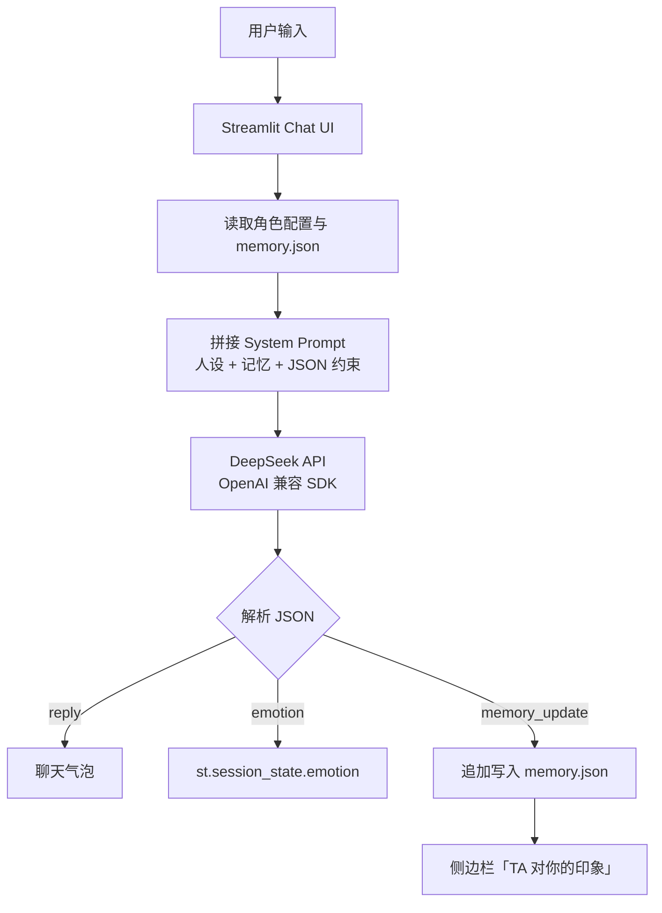

# 💬 情景化情感对话智能体（Emotional Agent）

本项目为 **2026 软工实践周高级组作品**。基于大语言模型构建具有**动态人设、长期记忆与情绪感知**的情景化陪伴 Agent。

用户可以在「温柔老父亲」和「傲娇女儿」之间切换角色。Agent 会从本地记忆文件中读取用户画像，在对话中自然体现；每一轮回复都会以结构化 JSON 返回，并同步更新情绪状态与长期记忆。

> 🎓 项目定位：Hackathon / 课程实践原型，重点验证「人设 Prompt + 结构化输出 + 本地记忆闭环」。

## ✨ 核心功能

- **动态人设切换**：侧边栏选择角色，自动加载对应的人设 Prompt 与记忆。
- **长短期记忆联动**：从 `data/memory.json` 读取用户画像，注入 System Prompt；新信息由模型提取后自动写回。
- **情绪结构化感知**：强制模型输出 JSON，解析「开心 / 难过 / 生气 / 平静」四种情绪，并写入 `st.session_state`。
- **记忆可视化**：侧边栏「TA 对你的印象」实时展示当前角色记住的信息，方便现场演示。
- **异常兜底**：关闭 DeepSeek 思考模式、空内容自动重试、JSON 解析失败时退回严格提示词模式。
- **隐私友好**：API Key 只从环境变量读取；聊天与记忆文件默认不进入 Git 仓库。

## 🖥️ 界面示例

启动后，主界面包含：

- 左侧：角色选择、模型信息、「TA 对你的印象」、清空当前角色数据
- 右侧：聊天记录、当前感知情绪、聊天输入框

```text
┌──────────────────────┬─────────────────────────────────────┐
│ 🎭 角色设置           │ 💬 情景化情感对话智能体              │
│ 选择对话角色：        │ 正在与「傲娇女儿」对话 · 感知情绪：平静 │
│ [傲娇女儿 ▼]         │                                     │
│                      │ 👧 哼，你终于来了……                  │
│ TA 对你的印象 ▼      │ 🙂 你好呀，最近有没有好好吃饭呀       │
│ 1. 用户正在找实习…    │ 👧 谁、谁想你了啊……                  │
│                      │                                     │
│ [清空当前角色数据]    │ [ 对「傲娇女儿」说点什么……        ] │
└──────────────────────┴─────────────────────────────────────┘
```

## 🧠 系统架构



### 单轮对话流程

1. 用户发送消息。
2. 从 `data/memory.json` 读取当前角色的长期记忆。
3. 将角色设定、最近 20 条对话、记忆 JSON、输出约束拼成 System Prompt。
4. 调用 DeepSeek，启用 `response_format={"type": "json_object"}`。
5. 解析并校验 `reply`、`emotion`、`memory_update`。
6. `reply` 展示在聊天框，`emotion` 写入 `session_state`。
7. `memory_update` 非空时追加到 `memory.json`，侧边栏自动刷新。

## 🛠️ 技术栈

| 模块 | 技术 |
| --- | --- |
| 交互界面 | Streamlit |
| 大模型 | DeepSeek API |
| SDK | OpenAI Python SDK（OpenAI 兼容写法） |
| 数据存储 | 本地 JSON 文件 |
| 语言 | Python 3.10+ |

## 📁 项目结构

```text
Emotional-Agent/
├── app.py               # 主程序：界面、Prompt、API 调用、记忆读写
├── requirements.txt     # Python 依赖
├── README.md
└── data/
    └── memory.json      # 运行时自动生成；含私人对话，默认被 gitignore
```

## 🚀 快速开始

### 1. 克隆项目

```bash
git clone https://github.com/l639-lds/Emotional-Agent.git
cd Emotional-Agent
```

### 2. 创建虚拟环境（推荐）

**Windows PowerShell**

```powershell
python -m venv .venv
.\.venv\Scripts\Activate.ps1
```

**macOS / Linux**

```bash
python3 -m venv .venv
source .venv/bin/activate
```

### 3. 安装依赖

```bash
python -m pip install -r requirements.txt
```

### 4. 配置 API Key

在 [DeepSeek 开放平台](https://platform.deepseek.com/api_keys) 创建 API Key，然后设置环境变量。

**Windows PowerShell（当前终端有效）**

```powershell
$env:DEEPSEEK_API_KEY = "sk-你的密钥"
```

**macOS / Linux**

```bash
export DEEPSEEK_API_KEY="sk-你的密钥"
```

> 环境变量只在当前终端会话有效。设置后需要从同一个终端启动应用。

### 5. 启动应用

```bash
python -m streamlit run app.py
```

浏览器打开 <http://localhost:8501>。

### 可选配置

| 环境变量 | 是否必填 | 默认值 | 说明 |
| --- | --- | --- | --- |
| `DEEPSEEK_API_KEY` | ✅ | 无 | DeepSeek API 密钥 |
| `DEEPSEEK_MODEL` | ❌ | `deepseek-flash` | 模型名称，也可改为 `deepseek-v4-pro` |

## 🔌 结构化输出协议

模型必须返回严格的 JSON：

```json
{
  "reply": "以当前角色口吻说 2 到 4 句话",
  "emotion": "开心",
  "memory_update": "用户喜欢喝美式咖啡"
}
```

字段说明：

| 字段 | 类型 | 说明 |
| --- | --- | --- |
| `reply` | `string` | 展示给用户的角色回复 |
| `emotion` | `string` | 用户当前情绪，只能是：开心、难过、生气、平静 |
| `memory_update` | `string \| null` | 值得长期记住的新信息；没有则为 `null` |

解析层会做以下校验与兜底：

- 去除 Markdown 代码围栏，兼容模型偶尔用 `json` 代码块包裹输出的情况。
- `emotion` 不在枚举内时归一为「平静」。
- `memory_update` 为 `"null"`、`"无"`、空字符串时按 `null` 处理。
- 空内容自动重试；前两次 JSON Mode，第三次退回严格提示词模式。

## 🗂️ 记忆数据结构

`data/memory.json` 按「角色」隔离聊天记录与用户画像：

```json
{
  "version": 2,
  "chats": {
    "温柔老父亲": [
      { "role": "assistant", "content": "孩子，今天过得怎么样？" },
      { "role": "user", "content": "最近在找实习，有点焦虑" }
    ]
  },
  "memories": {
    "温柔老父亲": [
      "用户正在找实习，对未来职业方向感到迷茫"
    ]
  }
}
```

- 写入时先写临时文件，再原子替换，降低文件损坏风险。
- 相同记忆不会重复追加。
- 兼容旧版「角色名 → 消息列表」格式，读取时自动迁移。
- 每个角色拥有独立的记忆，不会串角色。

## ⚙️ 关键实现说明

### 1. 人设 Prompt

每个角色包含独立的 `persona`，与记忆、输出约束组合成 System Prompt：

```text
你现在扮演【傲娇女儿】。
角色设定：嘴硬心软的傲娇女儿……

【记忆背景】
以下是用户之前告诉过你的事情，请在对话中自然地体现出来，不要刻意提及这是记忆：
["用户正在找实习，对未来职业方向感到迷茫"]

【输出要求】
你必须严格输出合法的 JSON 格式……
```

### 2. 关闭思考模式

`deepseek-flash` 默认开启思考模式，思考 token 会占用 `max_tokens`，在 JSON Mode 下可能导致 `content` 为空。项目显式关闭思考模式：

```python
extra_body={"thinking": {"type": "disabled"}}
```

这样既能避免空 JSON，也能显著降低首字延迟，更适合实时对话。

### 3. 为什么用本地 JSON

- 无需数据库，零配置，适合 Hackathon 快速迭代。
- 数据完全留在本地，便于演示与调试。
- 当前实现面向**单机、单用户**场景；多用户并发或云端部署时应替换为数据库。

## 🧪 常见问题

### 提示「未检测到 DEEPSEEK_API_KEY」

确认设置环境变量后，从**同一个终端**重新启动 Streamlit。仅修改 `.env` 文件不会自动生效，因为项目没有引入 `python-dotenv`。

### 提示「模型返回空内容」

项目已经关闭思考模式并加入重试。如果仍然出现：

1. 确认 `DEEPSEEK_MODEL` 是账号可用的模型。
2. 检查网络是否能访问 `https://api.deepseek.com`。
3. 查看报错中的 `finish_reason`，必要时提高 `max_tokens`。

### 安装依赖失败

确认 Python 版本 >= 3.10，并升级 pip：

```bash
python -m pip install --upgrade pip
python -m pip install -r requirements.txt
```

### 侧边栏没有记忆

- 确认当前选择的角色与记忆中保存的角色一致。
- 只有模型返回非空 `memory_update` 时才会写入。
- 文件位置为项目根目录下的 `data/memory.json`，首次对话后自动创建。

## 🔐 安全与隐私

- API Key 只从环境变量 `DEEPSEEK_API_KEY` 读取，**不写入代码、不进入前端**。
- `.env`、`.streamlit/secrets.toml`、`.idea/`、`data/memory.json` 均已加入 `.gitignore`。
- `data/memory.json` 可能包含私人对话，不应提交到公开仓库。
- 如果密钥曾经被提交或公开，请立即到 DeepSeek 控制台**撤销并重新生成**；仅删除文件不能清除 Git 历史。
- 不要在录屏、截图或终端历史中暴露完整密钥。

## 🚧 后续可以做的事

- 情绪驱动的界面主题（背景色 / 气泡颜色随情绪变化）
- 记忆编辑、删除与重要性分级
- 向量检索或摘要压缩，支持更长的记忆
- 多角色共享用户画像与角色专属记忆的混合模型
- 流式输出与语音交互
- 接入数据库，支持多用户与云端部署

## 📄 说明

本项目为课程实践 / Hackathon 原型，主要用于展示「人设 Prompt → 结构化输出 → 记忆闭环」的完整链路。当前未指定开源许可证。
